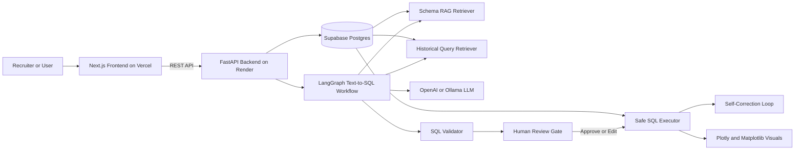

# Agentic Text-to-SQL Query Assistant

Live demo: `https://your-vercel-app.vercel.app`

An original deployment-ready Text-to-SQL project for a resume portfolio. It converts natural language business questions into safe SQL with a LangGraph workflow, FastAPI backend, human-in-the-loop review, session memory, RAG over schema and historical queries, self-correction, Plotly dashboards, Matplotlib PNG exports, and model benchmarking.

The app is designed for:

- Frontend: Vercel, Next.js
- Backend: Render, FastAPI
- Database: Supabase Postgres
- Local development: Docker Compose with Postgres

## Features

- Natural language question input
- Schema retrieval and historical-query retrieval before SQL generation
- LangGraph workflow nodes:
  - `understand_question`
  - `retrieve_schema_context`
  - `retrieve_historical_queries`
  - `generate_sql`
  - `validate_sql`
  - `human_review`
  - `execute_sql`
  - `self_correct_sql`
  - `generate_visualization`
  - `store_history`
- Human review before query execution
- Approve, edit, or reject generated SQL
- Safe `SELECT`-only validation with row limiting
- Self-correction using database error messages
- Session memory for follow-up questions
- Plotly chart JSON response
- Optional Matplotlib PNG export
- Demo mode when `OPENAI_API_KEY` and `OLLAMA_BASE_URL` are unavailable
- Rate limiting and optional `X-LLM-Access-Token` protection for expensive calls
- Benchmark endpoint and script for GPT-4/OpenAI and LLaMA-2/Ollama when configured

## Architecture



## Folder Structure

```text
.
├── backend/
│   ├── app/
│   │   ├── agent/
│   │   │   ├── demo_data.py
│   │   │   ├── graph.py
│   │   │   ├── llm.py
│   │   │   ├── rag.py
│   │   │   ├── sql.py
│   │   │   └── visualization.py
│   │   ├── benchmark.py
│   │   ├── config.py
│   │   ├── database.py
│   │   ├── main.py
│   │   ├── models.py
│   │   └── rate_limit.py
│   ├── requirements.txt
│   └── tests/
├── frontend/
│   ├── app/
│   ├── lib/
│   └── package.json
├── scripts/
│   └── run_benchmark.py
├── supabase/
│   └── schema.sql
├── Dockerfile
├── docker-compose.yml
├── render.yaml
└── .env.example
```

## Demo Questions

Demo mode supports these recruiter-safe questions over seeded business analytics data:

1. What is total revenue by month in 2026?
2. Which products generated the most revenue?
3. Show revenue by region.
4. What is average order value by customer segment?
5. Which customers have pending or failed payments?
6. Which product categories produce the highest gross margin?
7. Break down revenue by payment method.
8. Show last month revenue by region.
9. Who are our repeat customers by total spend?
10. Which sales managers own the most revenue?

Follow-up examples:

- Now group it by region
- Show only last month
- Plot this as a bar chart

## Local Development

Copy environment variables:

```bash
cp .env.example .env
```

Start Postgres, backend, and frontend:

```bash
docker compose up --build
```

Open:

- Frontend: `http://localhost:3000`
- Backend docs: `http://localhost:8000/docs`
- Health check: `http://localhost:8000/health`

Run backend without Docker:

```bash
cd backend
python -m venv .venv
source .venv/bin/activate
pip install -r requirements.txt
uvicorn app.main:app --reload
```

Run frontend without Docker:

```bash
cd frontend
npm install
npm run dev
```

## Environment Variables

Backend:

| Variable | Required | Description |
| --- | --- | --- |
| `DATABASE_URL` | Production yes | Supabase or Postgres connection string. If missing, local SQLite demo mode is used. |
| `FRONTEND_ORIGIN` | Yes | Vercel frontend URL for CORS. |
| `CORS_ALLOW_ORIGINS` | Optional | Comma-separated extra allowed origins. |
| `DEMO_MODE` | Optional | Set to `false` for real OpenAI SQL generation. If no LLM key is configured, the app safely falls back to demo mode. |
| `OPENAI_API_KEY` | Optional | Enables OpenAI SQL generation. |
| `OPENAI_MODEL` | Optional | Defaults to `gpt-4o-mini` for low-cost resume demos. |
| `OLLAMA_BASE_URL` | Optional | Enables Ollama model calls, for example `http://localhost:11434`. |
| `OLLAMA_MODEL` | Optional | Defaults to `llama2`. |
| `LLM_ACCESS_TOKEN` | Optional | Requires frontend or API clients to send `X-LLM-Access-Token` for expensive calls. |
| `RATE_LIMIT_PER_MINUTE` | Optional | In-memory per-IP rate limit. Defaults to `10`. |
| `QUERY_ROW_LIMIT` | Optional | Default result row cap for safe query execution. |

Frontend:

| Variable | Required | Description |
| --- | --- | --- |
| `NEXT_PUBLIC_API_URL` | Yes | Render backend URL. No API keys are exposed to the frontend. |

## Supabase Setup

1. Create a Supabase project.
2. Open the SQL editor.
3. Run `supabase/schema.sql`.
4. Copy the database connection string from Supabase.
5. Use the pooled or direct Postgres URI as `DATABASE_URL` in Render.
6. Make sure SSL is enabled in the Supabase connection string if your project requires it.

The schema includes:

- `customers`
- `orders`
- `products`
- `payments`
- `regions`
- `app_sessions`
- `query_runs`

## Render Backend Deployment

1. Push this repository to GitHub.
2. Create a new Render Web Service.
3. Select Docker deployment.
4. Use the root `Dockerfile`.
5. Set health check path to `/health`.
6. Add environment variables:
   - `DATABASE_URL`
   - `FRONTEND_ORIGIN=https://your-vercel-app.vercel.app`
   - `CORS_ALLOW_ORIGINS=https://your-vercel-app.vercel.app`
   - `DEMO_MODE=false` for real random-question LLM mode
   - `OPENAI_API_KEY`
   - `OPENAI_MODEL=gpt-4o-mini`
   - Optional `OLLAMA_BASE_URL`, `OLLAMA_MODEL`
   - Optional `LLM_ACCESS_TOKEN`
7. Deploy and confirm `https://your-render-service.onrender.com/health`.

## Vercel Frontend Deployment

1. Import the GitHub repository in Vercel.
2. Set the Vercel root directory to `frontend`.
3. Add environment variable:
   - `NEXT_PUBLIC_API_URL=https://your-render-service.onrender.com`
4. Keep the framework preset as `Next.js`; Vercel should use `npm install` and `npm run build` from `frontend`.
5. Deploy.
6. Copy the Vercel URL into Render:
   - `FRONTEND_ORIGIN`
   - `CORS_ALLOW_ORIGINS`

## Human Review Workflow

1. User asks a business question.
2. Backend retrieves schema context and similar session history.
3. LangGraph generates SQL.
4. Backend validates that the SQL is safe and `SELECT`-only.
5. Frontend shows SQL preview.
6. Reviewer chooses:
   - Approve: run generated SQL.
   - Edit: run reviewer-edited SQL after safety validation.
   - Reject: store rejection and feedback.
7. Backend stores the final status, SQL, chart config, feedback, and result metadata.

## Self-Correction Example

If an LLM generates:

```sql
SELECT customer_name, SUM(revenue)
FROM orders
GROUP BY customer_name;
```

The database may return an error such as `column customer_name does not exist`. The backend sends the failed SQL, error message, schema context, and session memory back through the correction path. A corrected query can become:

```sql
SELECT c.name AS customer, SUM(o.total_amount) AS revenue
FROM orders o
JOIN customers c ON c.id = o.customer_id
GROUP BY c.name;
```

The corrected SQL is revalidated as `SELECT`-only before retrying execution.

## API Examples

Create a session:

```bash
curl -X POST http://localhost:8000/sessions
```

Generate SQL:

```bash
curl -X POST http://localhost:8000/query \
  -H "Content-Type: application/json" \
  -d '{"session_id":"SESSION_ID","question":"Show revenue by region."}'
```

Approve SQL:

```bash
curl -X POST http://localhost:8000/review/QUERY_ID/approve
```

Edit SQL:

```bash
curl -X POST http://localhost:8000/review/QUERY_ID/edit \
  -H "Content-Type: application/json" \
  -d '{"sql":"SELECT r.name AS region, SUM(p.amount) AS revenue FROM regions r JOIN customers c ON c.region_id = r.id JOIN orders o ON o.customer_id = c.id JOIN payments p ON p.order_id = o.id WHERE p.status = '\''paid'\'' GROUP BY r.name ORDER BY revenue DESC"}'
```

Fetch history:

```bash
curl http://localhost:8000/history/SESSION_ID
```

Fetch chart JSON:

```bash
curl http://localhost:8000/chart/QUERY_ID
```

Fetch Matplotlib PNG:

```bash
curl -o chart.png "http://localhost:8000/chart/QUERY_ID?format=png"
```

## Benchmarking

The benchmark does not fake results. If OpenAI or Ollama is unavailable, the provider is returned as `skipped` with a clear reason.

Start the backend, then run:

```bash
python scripts/run_benchmark.py --api-url http://localhost:8000 --providers openai,ollama
```

With protected LLM mode:

```bash
python scripts/run_benchmark.py \
  --api-url https://your-render-service.onrender.com \
  --providers openai,ollama \
  --token your-llm-access-token
```

Metrics tracked:

- Execution success rate
- SQL correctness rate based on validation and benchmark requirements
- Average latency
- Error rate
- Per-question generated SQL and status

## Tests

Run backend tests:

```bash
cd backend
pytest
```

The included tests cover:

- Safe SQL validation
- Rejection of multiple statements and write queries
- Demo planner question coverage
- Follow-up mapping for session-style questions

## Resume Bullet Points

- Built an Agentic AI Text-to-SQL assistant using LangGraph and FastAPI to convert natural language questions into safe SQL for relational analytics data.
- Implemented RAG over database schema and historical queries to improve SQL generation accuracy and support session-aware follow-up questions.
- Added human-in-the-loop SQL review with approve, edit, and reject actions before execution.
- Enforced secure `SELECT`-only execution with validation, row limits, CORS controls, environment-based secrets, and rate limiting.
- Developed self-correction flow that uses database error messages to repair failed SQL and retry safely.
- Connected query outputs to interactive Plotly dashboards and optional Matplotlib PNG exports.
- Built recruiter-safe demo mode with seeded Supabase/Postgres business data and deterministic sample questions.
- Added benchmarking workflow to compare GPT-4-class OpenAI models and LLaMA-2/Ollama when provider credentials are configured.

